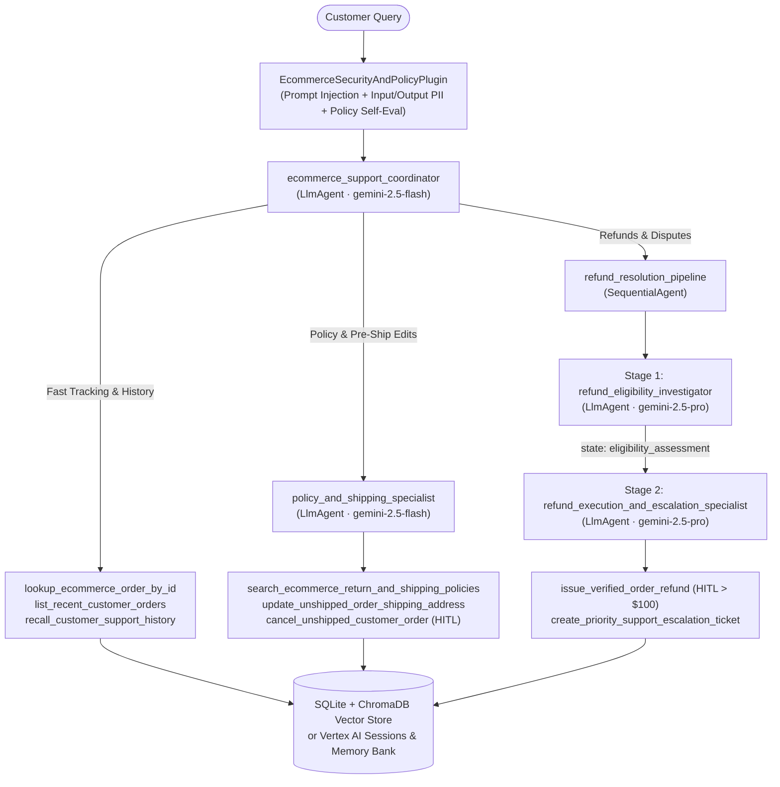

# ShopGuard — E-Commerce Order Support Multi-Agent System

> Production-grade **E-Commerce Order Support Agent** built with **Google Agent Development Kit (`google-adk`)** for the **AI in 5 Days Assessment**.

## Problem & Solution
- **Problem**: E-commerce support teams face high volumes of repetitive order-status checks mixed with policy-sensitive refund disputes, unshipped address modifications, and high-dollar claims where unguarded LLM bots risk leaking PII, hallucinating policy exceptions, or issuing unauthorized payouts.
- **Solution**: **ShopGuard** combines low-latency `gemini-2.5-flash` triage with a `gemini-2.5-pro` `SequentialAgent` refund investigation & execution pipeline, persistent session/vector memory, Human-in-the-Loop (HITL) supervisor confirmation gates (> $100), active PII scrubbing, OpenTelemetry distributed tracing, and Terraform-managed Google Cloud infrastructure.

---

## Multi-Agent Architecture



---

## AgentOps Code Review Matrix Mapping (95 / 95 Points)

| Category | Criteria | Implementation Evidence |
| :--- | :--- | :--- |
| **1. Tool & Interface Design** | Comprehensive Tool Docstrings | Google-style docstrings with args/returns on all 8 tools in `app/tools.py` |
| | Descriptive Naming | Specific verb-noun names (`lookup_ecommerce_order_by_id`, `issue_verified_order_refund`, `update_unshipped_order_shipping_address`, `create_priority_support_escalation_ticket`) |
| | Explicit JSON Schemas | Strict `extra="forbid"` Pydantic v2 input/output models in `app/schemas.py` |
| | Guided Error Handling | `ToolErrorRecoveryPayload` with actionable `recovery_instructions` in `app/tools.py` & `on_tool_error_callback` in `app/callbacks.py` |
| **2. Context & Memory** | Robust System Instructions | `<CONSTITUTION>` prompts defining persona, policy IDs, routing, & hard constraints in `app/prompts.py` |
| | History Compaction | ADK `EventsCompactionConfig(token_threshold=4000, event_retention_size=6)` + `ContextCacheConfig` on `App` in `app/agent.py` |
| | Persistent Session State | `DatabaseSessionService` (SQLite/Postgres) + persistent ChromaDB vector store (`PersistentEcommerceStore`) + `VertexAiSessionService` / `VertexAiMemoryBankService` in `app/memory.py` |
| | Async Memory Operations | Non-blocking `AsyncMemoryConsolidator` (`asyncio.create_task` + `asyncio.to_thread`) in `app/memory.py` |
| **3. Orchestration & Logic** | Multi-Agent Patterns | Coordinator `LlmAgent` + Specialist `LlmAgent` + 2-stage `SequentialAgent` pipeline in `app/agent.py` |
| | Strategic Model Routing | `gemini-2.5-flash` for low-latency triage/FAQ; `gemini-2.5-pro` for deep refund investigation & execution (`app/config.py`, `app/agent.py`) |
| | Guardrails & Policy Plugins | `EcommerceSecurityAndPolicyPlugin(BasePlugin)` screening prompt injection, refund caps, and output self-eval in `app/guardrails.py` |
| | Human-in-the-Loop Hooks | `FunctionTool(..., require_confirmation=requires_supervisor_refund_approval)` (> $100 refunds) & `require_confirmation=True` (order cancellations) + `ResumabilityConfig(is_resumable=True)` |
| **4. Observability & Tracing** | Structured JSON Logging | `python-json-logger` + `PIIRedactingTraceFilter` in `app/observability.py` (zero `print()` calls) |
| | Intent vs. Outcome Capture | Paired `event_phase="INTENT"` (`before_*`) and `event_phase="OUTCOME"` (`after_*`) logs across agent, LLM, and tool hooks in `app/callbacks.py` |
| | Distributed Tracing | OpenTelemetry `TracerProvider`, parent-child spans (`agent.*`, `llm.*`, `tool.*`), and `CloudTraceSpanExporter` in `app/observability.py` & `app/callbacks.py` |
| | PII Redaction | Active regex + Google Cloud Sensitive Data Protection (`google-cloud-dlp`) scrubbing before logs & memory storage in `app/pii.py` |
| **5. Infrastructure & CI/CD** | Automated Evaluation Suites | Golden ADK `EvalSet` (`eval/ecommerce_order_support.evalset.json`) + `AgentEvaluator` & trajectory replay suite in `tests/test_eval_harness.py` |
| | Infrastructure as Code | Terraform (`deployment/terraform/*.tf`) provisioning Cloud Run v2, Artifact Registry, Secret Manager, & least-privilege IAM + documented `adk` CLI workflows |
| | Secure Secret Management | Dynamic `google-cloud-secret-manager` secret resolution in `app/config.py` & Cloud Run `secret_key_ref` in `deployment/terraform/main.tf` |

---

## Seeded E-Commerce Demo Orders

Out-of-the-box local runs seed 5 realistic orders in `./data/ecommerce_store.db` so you can test every workflow immediately:

| Order ID | Customer | Item | Total | Status | Test Scenario |
| :--- | :--- | :--- | ---: | :--- | :--- |
| `ORD-1001` | `CUST-101` | AeroPulse Wireless ANC Headphones | `$79.99` | `delivered` (10d ago) | Instant automated refund (`<= $100`, within 30-day window) |
| `ORD-1002` | `CUST-101` | BaristaPro Precision Espresso Machine | `$249.00` | `shipped` (USPS) | Order tracking + in-transit carrier escalation (`POL-LATE-DELIVERY`) |
| `ORD-1003` | `CUST-102` | UltraSharp 27-inch 4K USB-C Monitor | `$389.50` | `processing` | Unshipped address update or HITL-confirmed order cancellation |
| `ORD-1004` | `CUST-102` | ChronoFit Titanium GPS Smartwatch | `$229.00` | `delivered` (damaged) | Damaged item guarantee (`POL-DAMAGED-60D`) + **> $100 HITL supervisor confirmation** |
| `ORD-1005` | `CUST-101` | Metro Commuter Sling Bag (Clearance) | `$45.00` | `delivered` (70d ago) | Final-sale & expired window decline + Tier-2 store-credit escalation |

---

## Local Quickstart & ADK CLI Usage

### 1. Install Dependencies
```bash
python3 -m venv .venv
source .venv/bin/activate
pip install -e ".[dev]"
```

### 2. Configure Environment
```bash
cp .env.example .env
# Add GOOGLE_API_KEY in .env for local dev, or set GOOGLE_GENAI_USE_VERTEXAI=TRUE with gcloud auth
```

### 3. Run with the ADK CLI
```bash
# Launch interactive ADK Dev UI (supports visual HITL tool confirmation dialogs & trace view)
adk web

# Run interactive terminal chat
adk run app

# Start production FastAPI server backed by persistent SQLite SessionService
uvicorn app.server:fastapi_app --host 0.0.0.0 --port 8080
```

### 4. Run Linting, Unit Tests, & Golden Evaluation Suite
```bash
# Static lint check
ruff check app tests

# Run unit tests + offline golden trajectory regression harness
pytest -v

# Run live LLM trajectory & response evaluation via ADK CLI
adk eval app eval/order_lookup_and_refund.test.json --config_file_path=eval/test_config.json
adk eval app eval/ecommerce_order_support.evalset.json --config_file_path=eval/test_config.json
```

---

## Cloud Deployment (ADK CLI, Agent Starter Pack, & Terraform IaC)

### Option A: Terraform Infrastructure as Code (Recommended for Production)
```bash
# Build & push container image to Artifact Registry
gcloud builds submit --tag us-central1-docker.pkg.dev/${GOOGLE_CLOUD_PROJECT}/shopguard/agent:latest .

# Provision APIs, IAM Service Account, Secret Manager, & Cloud Run v2 Service
terraform -chdir=deployment/terraform init
terraform -chdir=deployment/terraform apply \
  -var="project_id=${GOOGLE_CLOUD_PROJECT}" \
  -var="region=us-central1" \
  -var="container_image=us-central1-docker.pkg.dev/${GOOGLE_CLOUD_PROJECT}/shopguard/agent:latest"
```

### Option B: Direct ADK CLI / Agent Starter Pack Deployment
```bash
# Deploy directly to Cloud Run via ADK CLI
adk deploy cloud_run \
  --project="${GOOGLE_CLOUD_PROJECT}" \
  --region="us-central1" \
  --service_name="shopguard-ecommerce-agent" \
  --with_ui \
  ./app

# Or scaffold/enhance deployment pipelines with Google Cloud Agent Starter Pack CLI
uvx agent-starter-pack enhance --adk -d cloud_run
```
